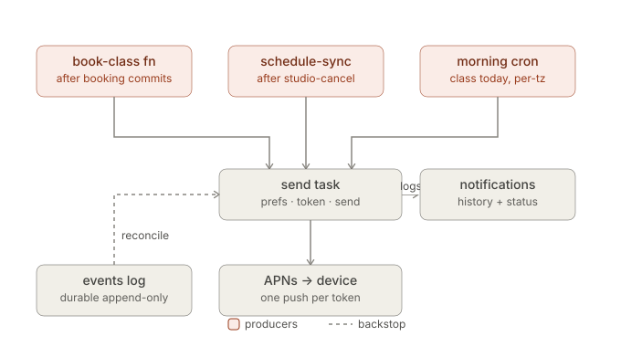

## Goal

- The goal we're trying to achieve is building push notifications for my iOS mobile app Moose. We're wanting to build it with Apples APNs server and not rely on third parties. This will be using existing infrastuture which we've already created. Listed below is what we currently have:

1. Trigger.dev - This is responsbile for cron jobs and will be responsible for batching and sending out the notifications to Apples server.
2. Swift app - This is the Moose app which currently already exists on the app store. <https://apps.apple.com/au/app/moose-studio-crossover/id6780323407>
3. Supabase backend - This is our backend run with Supabase.

- The notifications we will want to send out for v1 is below:

1. Session cancelled
2. Booking confirmed
3. Class today

### The Plan

#### Scope

| #   | Notification                                         | Trigger                  | Category                 |
| --- | ---------------------------------------------------- | ------------------------ | ------------------------ |
| 1   | **Session cancelled** (folds in "1 credit refunded") | Studio cancels a session | Transactional            |
| 2   | **Booking confirmed**                                | Member books a session   | Transactional            |
| 3   | **Class today**                                      | Morning-of reminder      | Transactional (reminder) |

- The sender is Trigger.dev is responsible for batching, scheduling and sending the notification to Apple server

#### Architecture

- Below is the architecutre diagram which we will use. This was generated by Claude.

- So the producers of the notification is the events table and the cron jobs.
  - The events table triggers a notification AFTER INSERT
  - The cron is run in Trigger dev and run on a schedule each day.
- Send location: The send tasks runs in the Trigger.dev node worker not an edge function as it needs to be long lived.

#### Data model

- With this new feature we will be introducing some new tables and columns to existing tables.

**The new tables are:**

#### `device_tokens` (Table)

| column                | notes                                                               |
| --------------------- | ------------------------------------------------------------------- |
| `id`                  | PK                                                                  |
| `member_id`           | FK `members(id)`, indexed                                           |
| `token`               | APNs device token (opaque), unique                                  |
| `platform`            | `ios` for now; column exists so Android/web slot in later           |
| `environment`         | `sandbox` / `production` (APNs env the token belongs to)            |
| `last_registered_at`  | updated on every re-upload from the app                             |
| `last_invalidated_at` | set when APNs returns 410/unregistered; row pruned or soft-disabled |

#### `notification_preference` (Table)

| column         | notes                                  |
| -------------- | -------------------------------------- |
| `member_id`    | FK                                     |
| `category`     | enum: `transactional`, `announcements` |
| `push_enabled` | bool                                   |

_Note: `push_enabled` isn't responsible for if the device recieves notifications that is still left up to Apple._

#### `notifications` (Table)

- One row per member visible notification dispatched. Doubles as the audit log, the delivery-state record and the backing store for a future in-app inbox.

| column                                             | notes            |
| -------------------------------------------------- | ---------------- |
| `id`, `member_id`, `notification_type`, `category` |                  |
| `title`, `body`, `deep_link`                       | rendered content |
| `event_id` / `broadcast_id`                        | provenance       |
| `delivered_at`, `read_at` (future inbox)           |                  |

#### `members.timezone` (Column)

- IANA tz string (e.g. Australia/Sydney), reported by the app. Drives the morning-of send. Nullable -> Falls back to the members home studios timezone.

## Day 1

- In day one I implemented the above data model and arch. We already had Trigger.dev implemented so I just needed to build out the triggers to fire the notification from the Trigger dev to the APNs and also the triggers within the edge functions to trigger the notification.

- Booking confirmed notification: This edge function `commitBooking` is called when a user has successfully booked into a class. Here we're triggering the `send-noitication` trigger dev task which will fire the notification off to Apple to then send to the device. _Question here is do we need to run a trigger.dev action here or can we just fire it directly as it will only be going to the one person??. Might be overkill using Trigger.dev..._
- Class cancelled notification: This is run via our Trigger dev cron which was already implemented. Essentially it runs daily and checks if any classes have been cancelled by the studio. If they have we update our database issue a refund to the users and then send a notification in a batch trigger. This triggers the same `send-notification` run we have already created in a batched trigger.
- Next up was the "You have a class today" notification. Again this would be housed in Trigger.dev as we will be notifying a large number of users with this so we want to ensure we can scale and aren't limited by edge function limits. Essentially within `runClassToday` function we load all the studios and members grouped by their timezone.

  _We're sending the notification based off the users device timezone which is updated to our backend each time the user goes on our app. We might want to change this to be off the studios timezone potentially?_

  We then run a rpc `find_class_today_members` and get all the memebers who have a class today in the timezone. This then triggers the `send-notification` which sends the notification

On top of this we generated the necessary keys for our sandbox and production APNS. Was a succesful few hours and planning to continue on with this over the week.

## Day 2

- After waking up and sleeping on things a bit I've reliazed I've over extended for v1 a little. In the design we're trying to manage all types of notifications e.g. transactional or announcements. Seeing all notifications in v1 are transactional I've scaled things back and removed the `notification_preference` table and removed the checks when making the necessary notification calls. When we have more types of notifications/emails we can implement this level of perference settings.
- After removing that I've now shifted my focus onto the client and implementing how we save the users device token, preferences screen and managing the notification permissions

## Day 3

- Goal of today is to finish off the client side. Currently I want to work out the best way to display the notification screen within the navigation stack. I want it to be a full screen off the tab view.
- Finally finished up with the client side of things took a little longer than I had hoped there were a few edge cases I was battling mainly around who was responsible for holding the is notification authorized or not. While its obvious the phone is the one with the over arching responsibility I wanted to make sure when the user navigated to the notificaion setting they could toggle the notification on or off. The key here is we couldn't toggle that on the native settings within the app so I made a decision as we will probably eventually allow users to opt out of categories within the notifications (rather than a clear on or off) that we would on the `device_tokens` table hold a `authorized` boolean this would be what we base our toggle off and each time the user opens the app we do a quick check to see if we need to update the authorized status on our backend if they've gone and changed it in the native settings. I believe this is safe as if the user turns notifications off on a native level then they will never get our notifications even if we have our authorized column toggled to TRUE because it will stop at the os level regardless of what we have. One thing where this might bite us in the ass is if the user had previously turned the notifications off and then natively goes and turns it on we won't update our column so the notifications won't get to them until they open the app... Issue we can monitor and address if things start to pop up. A fix to that would just be not have a check on our backend pass the user straight to their native settings when they press notifications in the settings screen on our app and always collect their device token.

## Day 4

- The goal of today is the finishing touches. Can confirm out notifications are sending and working. I want to test that the "classes today" notification works if there are issues then I might strip this out as a lot of users will user their calendar for that type of notification. On top of this I want to write some unit and e2e tests on the noticication settings and new code we've written.
